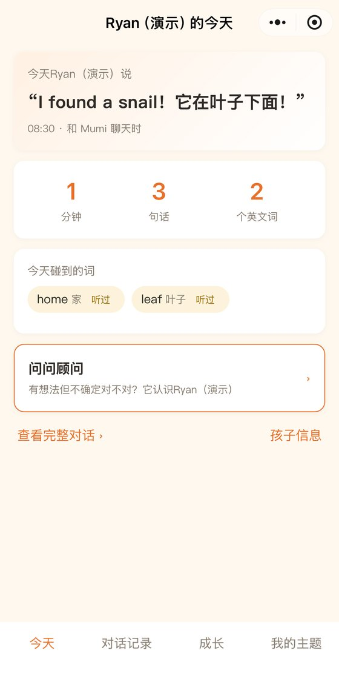
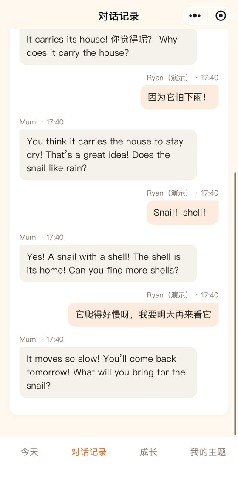
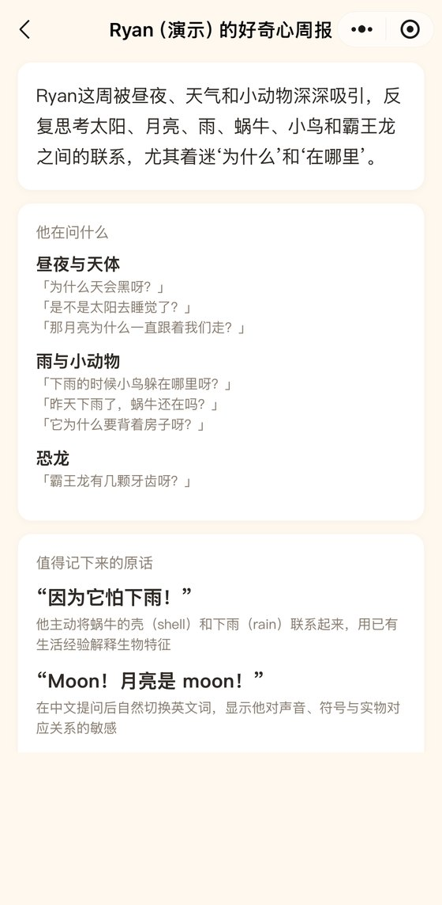

# KidsWise

**家长每天花 3 分钟，孩子每天能自己玩 30–40 分钟，而且玩得有收获；家长花的时间更少了，却比以前更懂孩子。**

孩子身边是 AI 小伙伴**木米**，家长手里是家庭教育 agent**北极星**。木米陪孩子玩出好奇心，北极星陪家长看懂孩子。

> 周三晚上六点，妈妈在厨房做饭，五岁的乐乐坐在地毯上。
> 木米先开口：「乐乐，我今天好奇一件事：家里有什么东西是圆的？我们找三个，好不好？」
> 乐乐拿来一个橙子、一个碗，又指了指墙上的钟。木米说：「钟也是圆的，round。你猜，为什么钟要做成圆的？」
> 「因为指针要转圈圈！」「这个问题问得好。我们把它编进今天的故事里吧。」
> 二十五分钟后，木米说：「去告诉妈妈你找到了什么圆的东西吧！」
>
> 晚上九点，北极星在妈妈的手机上说：「乐乐今天自己问了四个『为什么』，最喜欢的是『钟为什么是圆的』。睡前故事已经按今天的事编好了。」

---

## 木米：孩子自己造的 AI 小伙伴

木米面向 3–6 岁的孩子，没有屏幕。它的核心是一颗封装好的「木米芯」，负责听、说、看和记住。外面的样子由孩子决定：涂颜色、贴贴纸、换耳朵，或者画一张画，再变成打印出来的新外壳。

**一次 30–40 分钟的陪伴里，每 5–10 分钟换一个活动：**

1. **先开口**：「我今天好奇……」。话题来自孩子昨天说过的话，或者家长定下的方向
2. **动起来**：找一找、猜一猜、动手试，让孩子在家里跑起来
3. **讲一个孩子当主角的故事**：用上今天找到的东西和昨天提的问题，讲到关键处让孩子决定故事怎么走
4. **顺带认识**：一个字、几个英文词、一个科学小道理，不考试、不计数
5. **把孩子送回家长身边**：「去告诉妈妈你发现了什么吧」

木米还**记得**孩子：昨天没讲完的故事今天接着讲，上周说喜欢恐龙，这周的例子里就有恐龙。

## 北极星：认识你孩子的家庭教育 agent

| | 家长得到什么 |
|---|---|
| **看得懂** | 每天一句「今天他问了什么」、每周一份好奇心周报、每月一篇学习故事，一年攒成一本成长回忆录 |
| **用得上** | 按今天的经历编好的睡前故事；亲子聊天话题；结合孩子真实对话的育儿顾问 |
| **想得到** | 说一句「我想让他对数字有感觉，但不要做题」，北极星就起草成木米的一次活动，家长预览后一键发布；也可以借用别的家长的计划，改成自己家的版本 |

家长小程序（演示数据）：今天 · 对话记录 · 好奇心周报

## 设计原则

- **大模型不决定教什么，只决定怎么说。** 教什么以教育部《3–6 岁儿童学习与发展指南》为骨架；怎么教用对话式阅读、间隔复现这些有研究支持的方法；方向由家长定。
- **先开口，表扬提问本身。** 这个年纪的孩子不太会主动问。木米先给选择、再给开放题，孩子每问一个问题都会被具体地夸。
- **不只是知识，更看重品格。** 好奇、坚持、共情、自我控制、说到做到，这五种品格都在对话里培养，也能在对话里观察到。
- **成长不打分，但有台阶。** 不和别的孩子比，只和三个月前的自己比，比如从问「这是什么」到问「为什么」，再到自己提出猜想。
- **做兴趣，不做进度。** 不卖识字量，不做拼音进度，不做幼小衔接，也没有真人授课。

## 我们刻意不做的

- **木米是小伙伴，不是虚拟家人。** 遇到情绪问题和求助，它会把孩子引向家长，并通知家长。
- **默认每天不超过 40 分钟。** 家长可以调短；晚上十点到早上六点不主动说话。
- **不用积分、排行、连续打卡去拉时长。**

## 隐私

- 只记录孩子和木米的对话，以及孩子主动让木米看的东西，**不做全天候录音录像**
- 只在孩子说「你看这是什么」时拍一张照片，用完就删，不存储、不用于训练
- 家长随时能看到木米看过什么、聊过什么，可以让它「闭眼」，也可以一键导出、一键删除
- 孩子说的话和木米的回答都经过安全检查，受伤、走失这类求助会通知家长

## 现在的进度

- **整机**：能听、能说、能看，装在木星外壳里，孩子说完约 1 秒开口，可以中英混说
- **木米**：「未完待续」能接上昨天的话题，睡前回顾按当天真实发生的事来讲
- **北极星**：家长小程序和电脑端 studio，包括对话记录、好奇心周报、一句话起草活动、借用别的家长的计划、多个孩子切换
- **接下来**：家长和教育专家访谈，以及 10–20 个家庭的试用

## 仓库结构

| 目录 | 内容 |
|---|---|
| `agent/` | 木米和北极星的 agent 核心（Python / FastAPI）：人设、记忆、安全检查、视觉、家长端与 studio 接口，详见 [agent/README.md](agent/README.md) |
| `miniprogram/` | 家长端微信小程序，详见 [miniprogram/README.md](miniprogram/README.md) |
| `studio/` | 电脑端 studio，用来细调探索计划 |
| `firmware/` | 设备端固件配置（本地编译产物在 `firmware/builds/`，不进仓库） |
| `enclosure/` | 木星外壳的参数化建模与打印布局 |
| `deploy/` | 服务端部署（Docker Compose、Caddy、设备接入层配置） |
| `pilot/` | 试用用的监护人同意书和家长版隐私说明 |

## 历史命名

仓库原名 `waywise_kids_agent`，2026-10-21 起 Waywise 成为产品系列的总品牌，这个产品改名 KidsWise。下面这些内部名字还是旧的，**都属于 KidsWise，不是 Waywise 总品牌的东西**。它们不出现在用户界面里，改名要动线上环境，所以先没改：

| 旧名字 | 在哪里 |
|---|---|
| `waywise_agent` | agent 的 Python 包名 |
| `waywise-agent`、`waywise-xiaozhi` | Docker 容器名、镜像名 |
| `~/waywise/`、`/var/www/waywise-studio` | 服务器上的部署目录、studio 静态页目录 |
| `WaywiseAgent`、`WaywiseVLLM`、`WAYWISE_CAMERA_ROTATE`、`waywise-prompt.txt` | xiaozhi 的 provider 名、环境变量、提示词文件 |
| `waywise-parent` | 小程序工程名（`project.config.json`） |
| `api.waywise.tech` | 小程序和设备的接口域名，已登记为小程序合法域名 |

## 名字的由来

- **KidsWise**：Waywise 产品系列里陪孩子和家长的那一个。Waywise 的意思是认得路，也会找路：对孩子来说，是自己找路的本事；对家长来说，是在一堆互相打架的建议里，知道自己该往哪走。
- **木米**：第一位木米是一颗小木星，之后每个孩子造出来的，都是一颗不一样的星球。木是长出来的，米是喂大的；三到六岁的孩子差不多一米高。
- **北极星**：它不替你走路，只让你一直看得见方向。
